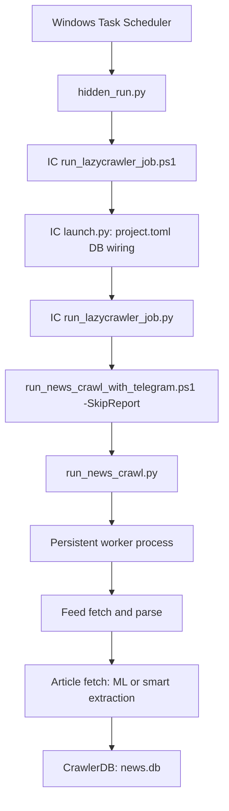

# Daily news crawl

**Purpose.** Preserve the news archive by collecting feed articles into `news.db`. The owner kept this crawl in the 23 November 2026 production cut because the archive cannot be rebuilt; reports, digests and Telegram delivery are off. The two configured jobs set `digest = false`; the dispatcher requires and passes `-SkipReport`, and the wrapper returns immediately after the crawl. [IC `config/lazycrawler_jobs.toml:14`](https://github.com/selvaz/investmentcommittee/blob/v0.2.32/config/lazycrawler_jobs.toml#L14), [IC `scripts/run_lazycrawler_job.py:211`](https://github.com/selvaz/investmentcommittee/blob/v0.2.32/scripts/run_lazycrawler_job.py#L211), [`run_news_crawl_with_telegram.ps1:59`](../../run_news_crawl_with_telegram.ps1#L59), [IC `config/databases.toml:107`](https://github.com/selvaz/investmentcommittee/blob/v0.2.32/config/databases.toml#L107).

| Task (`InvestmentCommittee_LazyCrawler_…`) | Pacific local time | Dublin local time |
|---|---|---|
| `News_Morning` | 23:00 daily | Normally 07:00 next day; 06:00 during the weeks when US and European DST changes do not coincide |
| `News_USClose` | 15:10 daily | Normally 23:10 same day; 22:10 during those DST mismatch weeks |

Times are wall-clock conversions, not fixed UTC offsets. The matrix specifies Pacific machine time; the actual registered task state and action should be checked in Task Scheduler. [IC `config/lazycrawler_jobs.toml:14`](https://github.com/selvaz/investmentcommittee/blob/v0.2.32/config/lazycrawler_jobs.toml#L14), [IC `config/lazycrawler_jobs.toml:46`](https://github.com/selvaz/investmentcommittee/blob/v0.2.32/config/lazycrawler_jobs.toml#L46).

The `hidden_run.py` hop is part of the supplied production-cut description; the registrar in the tagged IC source constructs a direct PowerShell task action, so the actual installed action must be verified separately. [IC `scripts/register_lazycrawler_candidates.ps1:203`](https://github.com/selvaz/investmentcommittee/blob/v0.2.32/scripts/register_lazycrawler_candidates.ps1#L203).

## Execution

1. The IC PowerShell launcher creates a per-job log and acquires a per-job lock; `launch.py` injects the live project's declared database paths and refuses missing required files. The Python dispatcher validates the matrix and sources, builds the wrapper command, and enforces the two-hour process-tree timeout. [IC `scripts/run_lazycrawler_job.ps1:40`](https://github.com/selvaz/investmentcommittee/blob/v0.2.32/scripts/run_lazycrawler_job.ps1#L40), [IC `scripts/launch.py:43`](https://github.com/selvaz/investmentcommittee/blob/v0.2.32/scripts/launch.py#L43), [IC `scripts/run_lazycrawler_job.py:179`](https://github.com/selvaz/investmentcommittee/blob/v0.2.32/scripts/run_lazycrawler_job.py#L179).
2. `run_news_crawl.py:main` loads the ordered YAML sources and starts a persistent worker. `_worker_loop` owns the database, cost session and ML/smart crawlers; `_feed_items` fetches and parses each feed, keeps undated entries, excludes entries older than 36 hours, and caps each source at 40 ML or 12 smart items by default. [`run_news_crawl.py:193`](../../run_news_crawl.py#L193), [`run_news_crawl.py:427`](../../run_news_crawl.py#L427), [`run_news_crawl.py:477`](../../run_news_crawl.py#L477).
3. `_crawl_item` calls `WebCrawler.crawl` for each URL with depth zero and robots respected. The pipeline checks the cache, fetches, extracts content with ML or the DeepSeek smart path, persists the result and session edge. Outcomes distinguish `new_page`, `refetched_identical`, `cache_hit` and `write_failed`; failures and timings are logged. [`run_news_crawl.py:124`](../../run_news_crawl.py#L124), [`run_news_crawl.py:199`](../../run_news_crawl.py#L199), [`lazycrawler/_pipeline.py:99`](../../lazycrawler/_pipeline.py#L99), [`lazycrawler/_pipeline.py:832`](../../lazycrawler/_pipeline.py#L832).
4. The parent enforces the budget and deadlines, counts outcomes, closes the worker and writes metadata including `_run_summary` and `SESSION_ID`. A completed non-timeout article resets the consecutive-timeout counter. [`run_news_crawl.py:104`](../../run_news_crawl.py#L104), [`run_news_crawl.py:632`](../../run_news_crawl.py#L632), [`run_news_crawl.py:774`](../../run_news_crawl.py#L774).

## Data and permissions

- **Reads:** IC `config/lazycrawler_jobs.toml`, `config/lazycrawler_sources.yaml`, live `project.toml`, existing news cache and remote feeds/articles. Source order and mode matter: ML is the no-LLM path; smart is used for selected foreign-language sources. [IC `config/lazycrawler_sources.yaml:10`](https://github.com/selvaz/investmentcommittee/blob/v0.2.32/config/lazycrawler_sources.yaml#L10), [`run_news_crawl.py:598`](../../run_news_crawl.py#L598).
- **News DB:** `LAZYCRAWLER_NEWS_DB` is wired to `C:\ProgramData\InvestmentCommittee\live\db\news.db`. `CrawlerDB` writes `sessions`, `pages`, `crawl_edges`, and its optional FTS index `pages_fts`; the schema also has `artifacts`, although article artifact extraction defaults off. SQLite journal/WAL files can accompany the DB. [`lazycrawler/db.py:82`](../../lazycrawler/db.py#L82), [`lazycrawler/db.py:165`](../../lazycrawler/db.py#L165), [`lazycrawler/config.py:164`](../../lazycrawler/config.py#L164), [IC `config/databases.toml:107`](https://github.com/selvaz/investmentcommittee/blob/v0.2.32/config/databases.toml#L107).
- **Cost and metadata:** the worker opens a LazyBridge cost-event SQLite DB, `NEWS_COST_DB` if set, otherwise `<LazyCrawler runtime>\reports\news\news_costs.db`, and registers `news_cost_sessions`. It writes `<runtime>\reports\news\<session>_meta.json`, with URL metadata and `_run_summary`. [`news_costs.py:11`](../../news_costs.py#L11), [`run_news_crawl.py:193`](../../run_news_crawl.py#L193), [`run_news_crawl.py:774`](../../run_news_crawl.py#L774).
- **Wired, not a crawl output:** `CRAWLER_ARTIFACTS_DB` (`C:\ProgramData\InvestmentCommittee\live\db\crawler_artifacts.db`) and `DIGESTS_DB` are required by the job matrix, but the skipped report stage does not write them. The `artifacts` table in `news.db` is a separate store. [IC `config/lazycrawler_jobs.toml:28`](https://github.com/selvaz/investmentcommittee/blob/v0.2.32/config/lazycrawler_jobs.toml#L28), [IC `config/databases.toml:138`](https://github.com/selvaz/investmentcommittee/blob/v0.2.32/config/databases.toml#L138), [`run_news_crawl_with_telegram.ps1:63`](../../run_news_crawl_with_telegram.ps1#L63).
- **Files and access:** the IC launcher writes `<RuntimeRoot>\logs\<job>\<yyyyMMdd_HHmmss>.log` and `<RuntimeRoot>\lock\<job>.lock`; the configured live root is `C:\ProgramData\InvestmentCommittee\live`. The registrar specifies the interactive `Administrator` account with limited run level. The process needs outbound HTTP(S) for feeds and articles, and DeepSeek API access for smart sources; the credential name is `DEEPSEEK_API_KEY`. No digest or Telegram credential is needed by the skipped stage. [IC `scripts/run_lazycrawler_job.ps1:40`](https://github.com/selvaz/investmentcommittee/blob/v0.2.32/scripts/run_lazycrawler_job.ps1#L40), [IC `scripts/register_lazycrawler_candidates.ps1:206`](https://github.com/selvaz/investmentcommittee/blob/v0.2.32/scripts/register_lazycrawler_candidates.ps1#L206), [`run_news_crawl_with_telegram.ps1:5`](../../run_news_crawl_with_telegram.ps1#L5).

## Limits and failures

Defaults: 100-minute crawl wall budget, 90 seconds per article (bounded by remaining budget), 30 seconds per feed, and a stop after five consecutive article timeouts. A worker is recycled after 200 items; startup gets three attempts by default. These settings can be overridden by the relevant `LAZYCRAWLER_NEWS_*` environment variables or CLI options. A failed feed is counted and the crawl continues; budget exhaustion, article errors, worker failure or timeouts make the run partial. [`run_news_crawl.py:498`](../../run_news_crawl.py#L498), [`run_news_crawl.py:632`](../../run_news_crawl.py#L632), [`run_news_crawl.py:774`](../../run_news_crawl.py#L774).

| Exit | Meaning |
|---|---|
| 0 | Crawl completed, or partial but meeting both write thresholds; check `_run_summary.partial`. Feed failures alone do not mark it partial. |
| 2 | Dispatcher/launcher configuration refusal; argument parsing can also return 2. |
| 4 | Consecutive-timeout circuit opened, or a partial crawl wrote fewer than one new page **or** fewer than 10% new pages per attempt by default. |
| 9 | Per-job lock held; no crawl started. |
| 124 / 125 | Two-hour outer timeout: process tree killed / tree death could not be confirmed. The latter retains the lock. |
| Other | Propagated child or launcher failure; inspect the log. |

[`run_news_crawl.py:115`](../../run_news_crawl.py#L115), [`run_news_crawl.py:654`](../../run_news_crawl.py#L654), [`run_news_crawl.py:774`](../../run_news_crawl.py#L774), [IC `scripts/run_lazycrawler_job.py:315`](https://github.com/selvaz/investmentcommittee/blob/v0.2.32/scripts/run_lazycrawler_job.py#L315), [IC `scripts/run_lazycrawler_job.py:407`](https://github.com/selvaz/investmentcommittee/blob/v0.2.32/scripts/run_lazycrawler_job.py#L407), [IC `scripts/run_lazycrawler_job.ps1:66`](https://github.com/selvaz/investmentcommittee/blob/v0.2.32/scripts/run_lazycrawler_job.ps1#L66).

JobHealth checks missing or unexpectedly disabled tasks, never-run tasks after a grace period, disallowed task results, hung runs, and stale locks; exit 9 alerts after two distinct consecutive runs. It also checks news session-origin drift, among its wider data and infrastructure checks. A stale lock is reported, and the launcher has dead-owner recovery; investigate possible orphaned writers before intervening. [IC `scripts/job_health.py:1`](https://github.com/selvaz/investmentcommittee/blob/v0.2.32/scripts/job_health.py#L1), [IC `config/job_health.toml:21`](https://github.com/selvaz/investmentcommittee/blob/v0.2.32/config/job_health.toml#L21), [IC `config/job_health.toml:62`](https://github.com/selvaz/investmentcommittee/blob/v0.2.32/config/job_health.toml#L62).

## Tests and production verification

Relevant tests: [`tests/test_news_deadlines.py`](../../tests/test_news_deadlines.py), [`tests/test_news_sources.py`](../../tests/test_news_sources.py), [`tests/test_news_costs.py`](../../tests/test_news_costs.py), [`tests/test_db.py`](../../tests/test_db.py), [`tests/test_wrapper_interpreter.py`](../../tests/test_wrapper_interpreter.py), and IC [`tests/test_lazycrawler_jobs.py`](https://github.com/selvaz/investmentcommittee/blob/v0.2.32/tests/test_lazycrawler_jobs.py) and [`tests/test_job_health.py`](https://github.com/selvaz/investmentcommittee/blob/v0.2.32/tests/test_job_health.py).

For an already completed production run, inspect the task result and its job log for per-source counts, article statuses or `TIMEOUT`, `_run_summary=`, `SESSION_ID=`, `report skipped (-SkipReport)`, and the final exit. Open the session's meta JSON and check `partial`, `reason`, `attempted`, `new_pages`, `timeouts`, `feeds_failed` and `write_failed`. To independently count new rows, read `news.db` in SQLite read-only mode and compare `pages` counts before and after the run; concurrent writers or updated existing pages mean that difference is not necessarily this session's `new_pages`. [`run_news_crawl.py:609`](../../run_news_crawl.py#L609), [`run_news_crawl.py:795`](../../run_news_crawl.py#L795), [`run_news_crawl_with_telegram.ps1:60`](../../run_news_crawl_with_telegram.ps1#L60).

**Versions and owners:** LazyCrawler `v0.19.11` owns crawl and news storage; investmentcommittee `v0.2.32` owns scheduling and deployment wiring. This card describes the stated 23 November production cut; installed Task Scheduler state was not independently inspected here.
